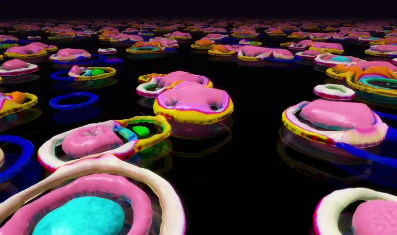
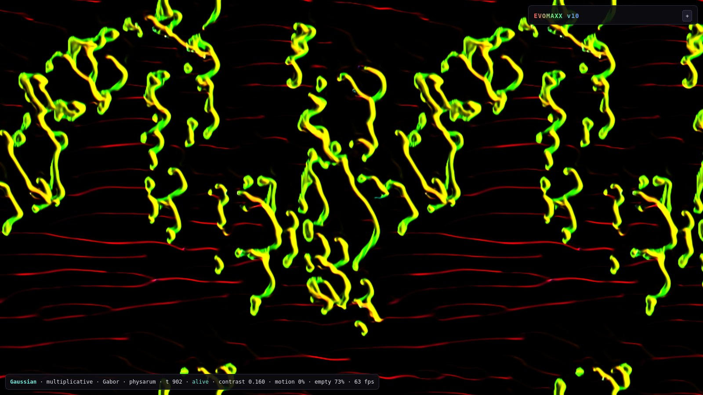
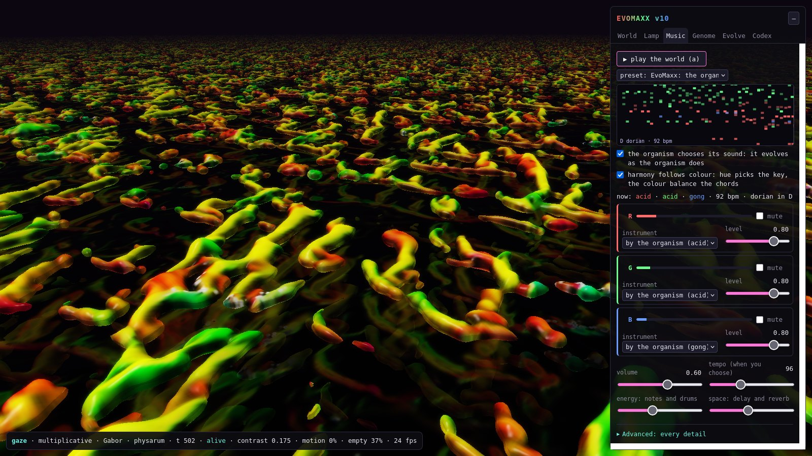

# EvoMaxx v10

**An artificial-life sandbox in which three chemicals evolve visuals and music.**

**Emre Ertürk** · Department of Computer Engineering, İzmir Institute of Technology

Every pixel of an EvoMaxx world is a colour, and its red, green and blue are three
chemicals. A small genome wires them together: each chemical senses its neighbourhood and
grows or decays in response. Out of that come moving, splitting, crawling organisms. The
world can be watched flat, or as a lava lamp of glowing wax floating above an endless floor,
and it plays itself as music: the organism's genome chooses its instruments, and the
colours choose the harmony.

Nothing is drawn by hand and nothing is pre-recorded. Every frame and every note is
computed live, on your GPU, from the rules.

<p align="center"></p>
<p align="center"><sub>Three organisms from the preset menu, recorded live: cell-like bodies in the lava lamp, physarum creatures in the flat view, and a colour-flocking world.</sub></p>

**[▶ Open EvoMaxx](https://emreerturk-3.github.io/evomaxx/)** · **[▶ A-life reproductions, live](https://emreerturk-3.github.io/evomaxx/reproductions/live/)**, or download this folder and
open `index.html`.

| | |
|---|---|
|  |  |
| A creature found by the experiments (Gaussian · multiplicative · Gabor · physarum) | The Music tab: the organism's own sound |

## Where it comes from

EvoMaxx grew from a small seed, **EvoMaxx v1**: about 200 lines of Python by its author, in
which the three colour channels of an image are three chemicals, a genome of eight regulation
rules is compiled into a GPU shader, and a pool of organisms evolves in real time, scored on
the field it paints ([legacy/](legacy/), with v1's source untouched and an analysis of how it
behaves). v10 is that idea measured, extended and tested over about 18,000 worlds, and v1's
own evolution still runs in it, in the Evolve tab.

It also borrows from the artificial-life literature: Lenia, Flow-Lenia, Turing patterns and
activator–inhibitor models, Physarum transport networks, cyclic dominance, Kuramoto
synchrony, random gene networks, Langton's edge of chaos, MAP-Elites, the sunflower's golden
angle and Euclidean rhythms. Each source is
**reproduced on its own** in [reproductions/](reproductions/), from the paper, with its
published results measured again (including what did not reproduce), and **runs live** in the
[reproductions viewer](https://emreerturk-3.github.io/evomaxx/reproductions/live/).

**[EXPLAINED.md](EXPLAINED.md)** puts it together for the curious: what each piece of
EvoMaxx is, where it comes from, what is EvoMaxx's own, and what the experiments found.

## What you can do

- **Watch and play with a world.** Paint chemicals into it, erase, zoom, pan, pause and
  step. Reseed it, mutate its genome a little, or draw a new one. Start from an organism
  the experiments found (the preset menu).
- **The lava lamp** (`p`). The 2D world becomes an endless floor and its bright matter
  floats above it as wax: bodies rise as they heat up and sink as they cool, cast shadows,
  glow through thin edges and reflect in the wet floor. Light, fog, glow, thickness and
  roundness are all adjustable, and the camera can glide into shots, follow a creature
  (`t`) or fly slowly over the floor (`g`).
- **Music** (`a`). The world plays itself (see below). Keep it simple, or open
  *Advanced* for every detail: channel strips, sources, harmony, effects, MIDI out.
- **The genome.** Every number of the genome is a live slider: drag it and the world
  follows. Copy and paste genomes as text.
- **Evolve.** *The original evolution* (`o`) runs EvoMaxx v1's own loop on the living world:
  a pool of 12, a mutated child every 90 steps, the two fittest crossed every 270, fitness
  read from the field with v1's score, and an extinction event (keep the best, re-seed) when
  the world goes flat. *Morph* turns the living world into another organism: continuous genes
  glide, discrete choices switch halfway, and the world is never reseeded. *Discover*
  (MAP-Elites) tests genomes nine at a time and keeps the best of each kind in an 8 × 8
  atlas, by colour and by activity; click any to open it.
- **Keep what you find.** The codex stores organisms with thumbnails in your browser,
  exports and imports them as JSON, and makes share links: anyone who opens the link sees
  the same organism.
- **Capture.** Record a video with its sound (`c`), record the music alone, or save a
  screenshot (`k`).

## How it works

**The state.** A torus of cells (256², 512² or 1024²). Each cell holds a colour
x = (r, g, b) in [0, 1]³: three chemicals and nothing else.

**One step.**

1. **Sense.** Three neighbourhood fields N₀, N₁, N₂ are computed with a kernel family,
   at three sizes.
2. **Respond.** Eight genes. Gene i reads chemical *src* in field *ring* and adds
   w · f((N − μ) / σ) to chemical *dst*.
3. **Update.** A delta turns the summed growth G into the new colour.
4. **Move.** An optional colour physics either rotates colours locally, or moves matter
   with mass-conserving transport (reintegration tracking, as in Flow-Lenia).

The genome is the wiring (src, dst, ring) and shape (w, μ, σ) of the eight genes, a few
global numbers, and the choice of kernel, delta, response and physics:

| part | choices |
|---|---|
| **kernels** (17) | box (v1, the original), dense box, disc, Gaussian, Lenia shell, double shell, thin ring, Mexican hat, exponential, plus, hexagonal shell, spiral shell, dipole, Bessel rings, phyllotaxis (the sunflower spiral), power law, **gaze** (each cell looks in the direction of its own hue) |
| **deltas** (10) | v1 decay x(1−d) + s(b+G), Lenia x + sG, asymptotic, logit, multiplicative x·e^(2sG), momentum, noisy, zero-sum, **cyclic dominance** (rock-paper-scissors between the chemicals), Nagumo (excitable) |
| **responses** (16) | Gaussian, sine, band, triangle, tangent, wavelet, logistic, bistable cubic, Lorentzian, bimodal, sinc, triangle wave, Gabor, chirp, Hill, logistic map |
| **physics** (9) | none, **hue transport** (hue is the heading, saturation the speed), colour flocking, colour precession, colour game (replicator dynamics), chemotaxis, swirl, currents, **physarum** (matter senses ahead along its hue and steers towards its own kind, like a slime mould) |

That is 24,480 combinations of the rule alone, before any gene is drawn.

**Health.** A world is measured from 8 × 8-cell block statistics. It is *dead*, *frozen*,
*noise* or *alive*, and its motion, drift and emptiness are measured too. Dead worlds are
reseeded automatically, and the lava lamp floats only the brightest quarter of the world.

### What the experiments found

The defaults were not chosen by eye. They come from controlled experiments on fresh random
genomes: randomised factorial screens followed by held-out confirmation, with paired
comparisons and exact McNemar tests (about 18,000 worlds in all).

- **Lifelike worlds** (alive, and moving or forming patterns on an empty background).
  Mexican hat · v1 decay · tangent · hue transport is lifelike for **95 %** of fresh
  genomes, against 7 % for v1's original rule. It is the default.
- **Creatures** (localised organisms on an empty background). Physarum physics with the
  gaze or Gaussian kernel, multiplicative delta and Gabor response gives creatures for
  **80–82 %** of fresh genomes, against 22 % for the best rule before it, with no genome
  lost (p ≈ 10⁻⁷). These organisms open the preset menu.
- Some ideas failed and are reported as such: Bessel-ring kernels and the Hill response
  rarely produce life.

## The music

The world plays itself, with WebAudio synthesis and no samples. Each chemical has a channel
strip, and every note goes through the strip of the chemical it came from.

- **Music box.** A bar sweeps across the world and the bright cells under it sound. Their
  pitch comes from their position, their loudness from their brightness.
- **Genome melody.** The eight genes are a sequence. A gene's μ is its pitch, |w| its
  loudness (weak genes rest), σ its length, and inhibitory genes sound an octave lower.
  When the genome changes, the melody changes.
- **Bells** ring when a body forms, and a low note sounds when one fades.
- **Drone and drums.** A drone per chemical swells with its mass and trembles with motion.
  The drums follow the world's motion, or play Euclidean rhythms whose pulse counts are the
  numbers of bodies of each colour.
- **The organism's own sound** (on by default). The genome picks the instruments (a palette
  of families from the rule, the instrument, octave and brightness of each chemical from its
  genes), plus the tempo, scale, swing, drum style and melody order. Small mutations shift
  the sound a little; a new species sounds new. 400 random genomes gave 383 different
  voices, using all 28 instruments.
- **Harmony follows colour.** The key follows the hue around the circle of fifths, after
  Scriabin's colour-key circle, and changes only on a bar line. The colour balance picks
  each bar's chord (red-led home, green-led subdominant, blue-led dominant), and strong
  beats keep to it.
- **28 instruments** in seven families: bells, keys, plucked, winds and voices, strings and
  pads, synth, bass. One of them, *colour*, builds each note's spectrum from the colour of
  the cell it came from.
- **For the nerds.** 15 scales; equal, just or Pythagorean tuning; tempo, swing, delay,
  reverb, drive and tone; presets; MIDI out (R, G, B on channels 1–3, drums on 10); and a
  microphone that feeds the world: bass drops red ink, mids green, treble blue.

## Controls

| key | | key | |
|---|---|---|---|
| `space` | pause | `p` | flat view / lava lamp |
| `n` | one step | `a` | music on / off |
| `r` | reseed | `t` | follow a creature |
| `m` | mutate a little | `g` | dolly over the floor |
| `x` | new random genome | `arrows` | glide |
| `f` | fit to screen | `c` | record video |
| `s` | save to the codex | `k` | screenshot |
| `v` / `e` | world / discover atlas | `h` | hide the panel |

In the flat view, left-drag paints, shift-drag erases, right-drag moves and the wheel zooms.
In the lava lamp, left-drag looks around, right-drag moves over the floor, the wheel zooms
and shift-drag pours ink from the sky.

## Running it

- **Online:** open the GitHub Pages link above.
- **Offline:** download this folder and open `index.html` in a current Firefox, Chrome,
  Edge or Safari (WebGL 2 is required). The microphone and MIDI need a secure page: use the
  online version, or serve the folder locally with `python3 -m http.server` and open
  `http://localhost:8000`.
- **Speed.** The lava lamp wants a dedicated GPU. On laptops with two GPUs, let the browser
  use the dedicated one (Windows: Settings → Display → Graphics). On Linux,
  `./open-on-nvidia.sh` starts Firefox with PRIME offload. The app tells you when it finds
  itself on an integrated GPU, and lowers its render quality (never below 60 %) to keep
  moving.


## Files

```
index.html          the page
css/evomaxx.css     its style
js/engine.js        the chemistry on the GPU (WebGL 2): catalogue, genomes, shaders, health, flat view, lava lamp
js/audio.js         the music: instruments, the organism's voice, harmony, sequencing, effects
js/app.js           the app: panels, input, camera, codex, v1 evolution, discover, morph, capture
js/presets.js       organisms found by the experiments
docs/               pictures for this page
EXPLAINED.md        the in-depth report: from the seed to v10, idea by idea
reproductions/      the sources, reproduced one by one (Python), and live/ (all of them in WebGL 2)
legacy/             EvoMaxx v1, the seed: its source untouched, and an analysis of it run headless
open-on-nvidia.sh   Linux: start Firefox on the dedicated GPU
```

## Background and references

The full story, with every source reproduced, is in [EXPLAINED.md](EXPLAINED.md) and
[reproductions/](reproductions/). The main references:

- A. M. Turing, *The chemical basis of morphogenesis*, Phil. Trans. R. Soc. B 237 (1952).
- S. A. Kauffman, *Metabolic stability and epigenesis in randomly constructed genetic nets*,
  J. Theor. Biol. 22 (1969).
- C. G. Langton, *Computation at the edge of chaos*, Physica D 42 (1990).
- B. W.-C. Chan, *Lenia: biology of artificial life*, Complex Systems 28 (2019).
- E. Plantec et al., *Flow-Lenia: towards open-ended evolution in cellular automata through
  mass conservation and parameter localization* (2023); M. Moroz, reintegration tracking (2020).
- J.-B. Mouret & J. Clune, *Illuminating search spaces by mapping elites* (2015).
- J. Jones, *Characteristics of pattern formation and evolution in approximations of
  Physarum transport networks*, Artificial Life 16 (2010).
- R. M. May & W. J. Leonard, *Nonlinear aspects of competition between three species*,
  SIAM J. Appl. Math. 29 (1975).
- H. Vogel, *A better way to construct the sunflower head*, Math. Biosci. 44 (1979).
- G. Toussaint, *The Euclidean algorithm generates traditional musical rhythms* (2005).
- A. Scriabin's colour-key circle for *Prometheus: The Poem of Fire* (1910).

## Citation

```bibtex
@misc{erturk2026evomaxx,
  author = {Ertürk, Emre},
  title  = {{EvoMaxx}: three chemicals that evolve visuals and music},
  year   = {2026},
  url    = {https://github.com/EmreErturk-3/evomaxx}
}
```
