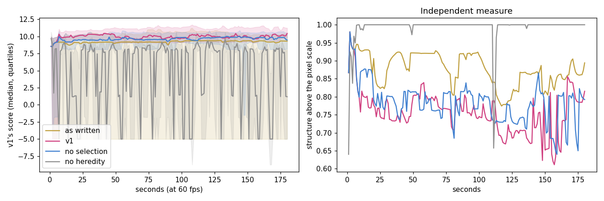
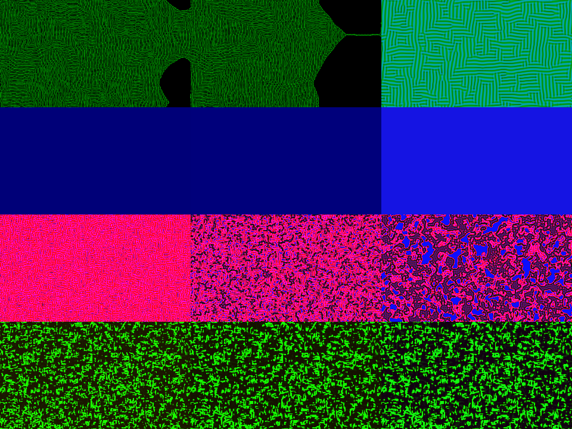
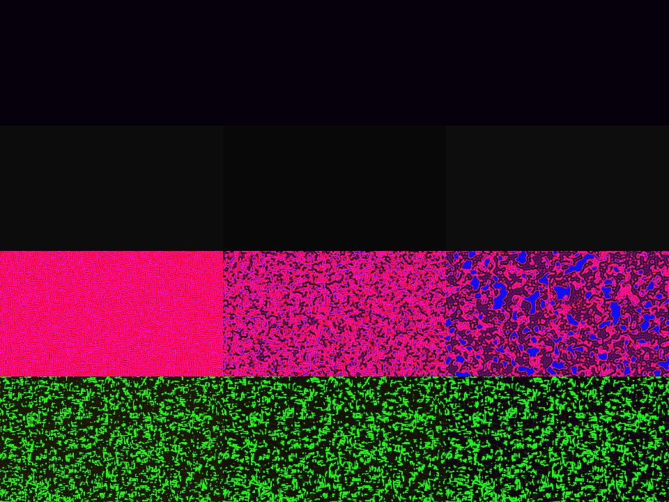

# EvoMaxx v1: the seed

EvoMaxx v1 is where EvoMaxx starts: about 200 lines of Python by its author. Its own README
opens with:

> Open-ended evolution of reaction-diffusion Gene Regulatory Networks on the GPU.
> RGB channels are the three chemical species. The shader IS the organism.

[v1/](v1/) holds it exactly as it was released: [genome.py](v1/genome.py),
[main.py](v1/main.py), its [README](v1/README.md) and the PyInstaller spec. [v1-analysis/](v1-analysis/)
runs it headless and measures what its parts do.

## What v1 is

**The organism.** A genome has eight genes and three global numbers. Each gene reads one
chemical (R, G or B), averaged over one of three neighbourhoods: a 3 × 3 box, a 7 × 7 box,
or a 7 × 7 lattice of spacing 2. It passes the average through a Gaussian bump and adds the
result, with weight ρ, to one chemical:

    res_c = bias + Σ_{genes with target c} ρ · exp(−((k_ring[src] − μ) / σ)²)
    next  = clamp(c (1 − decay) + speed · res, 0, 1)

The genome is not interpreted. It is written out as GLSL and compiled into the compute
shader that runs the world (1280 × 720, 32-bit floats, a torus). The picture is the field
itself, with a display gamma of 0.75 and no other rendering.

**Evolution, in real time, on one living world.**

| | every | what happens |
|---|---|---|
| mutation | 90 frames | the running organism's child (one or two genes nudged, sometimes the global numbers) joins the pool of 12, replacing the least fit, and takes over the world |
| crossover | 270 frames, *or every frame while no organism in the pool is fitter than 0.5* | the two fittest are crossed gene by gene; the child takes over |
| fitness | 60 frames | the running organism's fitness ← 0.7 · fitness + 0.3 · score(field) |
| extinction | SPACE | a fresh pool, the best genome kept, the field re-noised |

The field is never reset when organisms change. Each new rule inherits the world its parent
made. The score is computed from the field on a 12-pixel grid. It is −10 for a dead or
saturated world and −5 for one whose values barely vary. Otherwise it rewards edges near
0.2, differences between the chemicals, a mean brightness near 0.35, and variation within
each chemical.

## The analysis

[run_v1.py](v1-analysis/run_v1.py) imports v1's `genome.py` unchanged. It runs `main.py`'s
loop and `score()` line for line, without the window, on an offscreen OpenGL context. Four
conditions, 10 runs each of 10,800 frames (3 minutes at 60 fps), with the same seeds across
conditions:

| condition | what changes |
|---|---|
| **as written** | nothing: v1 exactly, with nobody at the keyboard |
| **v1** | a player who presses SPACE after 5 s of a flat screen, as v1 expects |
| **no selection** | as v1, but the fitness update uses a random number in v1's usual score range (8–12): the loop runs as before, but fitness carries no information |
| **no heredity** | as v1, but every 90 frames a brand-new random organism replaces mutation and crossover |



### Results

| | as written | v1 | no selection | no heredity |
|---|---|---|---|---|
| v1's score, last 30 s (mean of 10 runs) | 4.27 | **9.96** | 8.44 | 2.55 |
| median | 9.29 | 9.76 | 9.77 | 2.61 |
| share of time flat grey or dark (score ≤ −5) | 40 % | 2 % | 5 % | 37 % |
| runs that end flat grey or dark | 4 of 10 | 0 | 0 | 0 |
| runs that end near-uniform in any colour (structure share > 0.98) | 5 | 3 | 1 | 7 |
| extinction events per run | – | 0.7 | 1.8 | 4.8 |
| genomes tried per run | 1,302 | 270 | 252 | 185 |

**Left alone, a v1 world can die for good.** v1 has no noise. Once the field is uniform,
almost no rule can break the symmetry again, so 4 of 10 untouched runs went flat and stayed
flat. v1 was made to be played: painting and SPACE bring the variation back. With a player
who presses SPACE when the screen goes flat, no run ended flat.

**v1 thrashes when every fitness is low.** Before the first scoring every fitness is 0, so
the rule "crossover while no fitness exceeds 0.5" fires on every frame. Each run makes 60
crossover children in its first second (72 genomes by frame 60). In one untouched run (run
6) the whole pool fell below 0.5 after the world went flat, and the rule kept firing for the
rest of the run: 10,700 genomes in 3 minutes, each living one frame. This is why "as
written" averages 1,302 genomes per run.

**v1's score cannot tell a pattern from a solid colour.** Its flatness test looks at the
spread of all values together, channels included, so a world of one pure colour passes it.
A uniform pure red, green or blue field scores **11.16**, more than the median patterned
world in these runs (about 9.8), and a uniform dark blue scores 8.87. Only grey or dark
uniform worlds count as flat. Several high-scoring runs are in fact a single colour: in the
v1 condition, runs 1, 7 and 8 end near-uniform with scores of 8.5 to 9.8. Run 1 below is
plain blue at every snapshot.

**Heredity is what keeps a v1 world alive.** Replacing mutation and crossover with fresh
random organisms dropped the score from 9.96 to 2.55. It was lower in all 10 paired runs
(Wilcoxon signed-rank and sign test, p = 0.002). The world was flat grey or dark 37 % of the
time even with the player pressing SPACE, and 7 of 10 runs ended near-uniform. A small
mutation keeps the rule close to one that already sustains a pattern; a random rule usually
wipes it out.

**Selection by score: no clear effect in 3 minutes.** With fitness made meaningless, the
median score was unchanged (9.77 against 9.76). The mean fell from 9.96 to 8.44, but v1 was
ahead in only 6 of 10 paired runs (Wilcoxon p = 0.32). The difference comes from two runs
where the uninformed pool collapsed, and it shows in more extinction events (1.8 against 0.7
per run). On this time scale v1's score works mostly as a guard against collapse, not as a
force that climbs. That is not surprising, given that the score's best value is a solid
colour. If anything, selection on it may favour uniform worlds: 3 of 10 v1 runs ended
near-uniform against 1 of 10 without selection. That is too few runs to claim, but it points
the same way. v1's patterns come from its rules and from heredity, not from the score.



*v1 with the player, runs 0–3 at 1, 2 and 3 minutes. Run 1 is a uniform blue throughout,
yet scores 8.5. The others show v1's own modes: Turing labyrinths, weaves and domains.*



*As written, the same runs: runs 0 and 1 went flat and stayed flat.*

**Limits.** Ten runs of 3 minutes, one rule family (v1 has only the Gaussian), and v1's own
score as the main measure, which, as shown above, rewards solid colour. v1 was meant to run
for as long as someone watched. The second measure, the share of variation above the pixel
scale (right panel of the figure), is 1.0 for a uniform field. It flags uniform worlds but
does not rank patterned ones by quality.

## What v10 keeps from it

- **Colour as chemistry, the shader as the organism, the field never reset.** These are
  EvoMaxx's foundations. *Morph*, which turns the living world into another organism without
  reseeding, is the descendant of v1 swapping organisms on a world that keeps going.
- **v1's rule** is one of v10's rules: kernel *box (v1)*, delta *v1 decay*, response
  *Gaussian*. It is the baseline in every v10 experiment, lifelike for 7 % of fresh genomes,
  against 93–95 % for v10's default.
- **v1's evolution** runs in v10: Evolve tab, *the original evolution* (key `o`). It has
  the same pool of 12, the same timings, mutation, crossover and score, with the
  extinction on a flat world switchable. Its world is smaller (512² by default) and is drawn
  by v10's renderer.
- What this analysis found is why v10 measures worlds differently. Heredity matters, the
  score mostly guards against collapse, and a solid colour can win. v10's health measures
  the spatial variation within each chemical separately, so a uniform world of any colour
  is classed dead, never alive. *Discover* searches for diversity (MAP-Elites) instead of climbing one
  score.

## Running

```bash
cd v1 && python main.py                                    # v1 itself: pygame, moderngl, numpy
cd v1-analysis && ./run_v1.py 10 10800                     # the analysis: moderngl, numpy, matplotlib, pillow
```

v1 needs a GPU with OpenGL 4.3. The analysis uses an offscreen EGL context, so it runs
without a window. On a laptop GPU it takes about 80 s per run.
