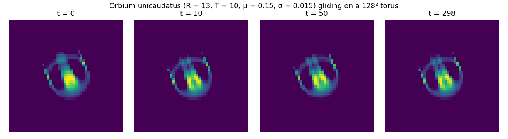
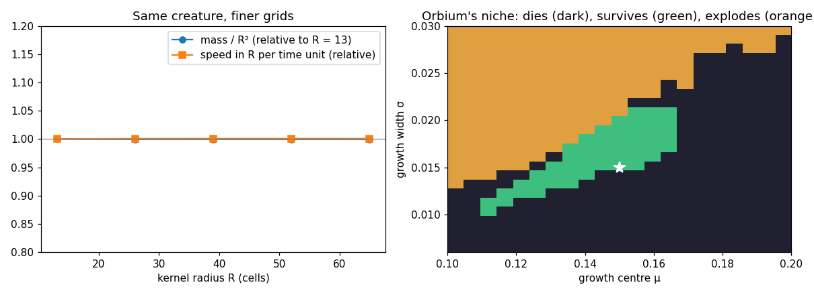

# Lenia: Orbium, its scale and its niche

Reproduction of B. W.-C. Chan, *Lenia: Biology of Artificial Life*, Complex Systems 28
(2019) 251–286, [arXiv:1812.05433](https://arxiv.org/abs/1812.05433), with Orbium from the
author's pattern library ([Chakazul/Lenia](https://github.com/Chakazul/Lenia)).

Lenia is a continuous cellular automaton. Each cell holds a value between 0 and 1, senses a
smooth ring of radius R around itself, and grows or shrinks by a bell-shaped function of what
it senses. Among its "species" the best known is *Orbium*, a glider.



**▶ Live:** [the reproductions viewer, Lenia](../live/index.html#lenia)

## Model

| Element | Paper | Here ([lenia.py](lenia.py)) |
|---|---|---|
| Update | A ← clip(A + dt G(K ∗ A), 0, 1), dt = 1/T (Eq. 16) | same, on a torus, convolution by FFT |
| Kernel | one shell (β = [1]), exponential core exp(4 − 1/(r(1 − r))), r = \|x\|/R, normalised to 1 | same |
| Growth | G(u) = 2 exp(−(u − μ)²/(2σ²)) − 1 (Eq. 13) | same |
| Orbium | R = 13, T = 10, μ = 0.15, σ = 0.015 (library entry O2u; the paper's Fig. 6 caption writes σ = 0.016) | library values |
| Seed | the library's 20 × 20 cells, run-length encoded | decoded with the library's own rules, stored exactly as k/255 |

**Not stated in the paper:** how a pattern is rescaled to another R. Here the settled creature
(after 50 time units at R = 13) is enlarged bilinearly. The raw 20 × 20 seed, enlarged
bilinearly, *dies* at R = 26; enlarged cubically it survives at R = 26 and 39 but not at 52.
The settled creature is smoother, and survives at every R tried.

## Results

**Orbium lives and glides.** Over 1,000 time units on a 128² torus its mass stays at
0.4208 R² (spread 0.24 %), and it moves at 0.473 R per time unit.

**Mass and speed do not depend on the resolution** (paper, Fig. 7: "mass and linear speed stay
roughly constant across space resolutions"):

| R | 13 | 26 | 39 | 52 | 65 |
|---|---|---|---|---|---|
| mass / R² | 0.4209 | 0.4207 | 0.4207 | 0.4207 | 0.4207 |
| speed (R per time unit) | 0.4730 | 0.4734 | 0.4734 | 0.4734 | 0.4734 |

Lenia behaves as a discretisation of a continuous system: the same creature at five times
the resolution is the same creature.

**Orbium's niche is narrow.** Over a 21 × 25 grid of (μ, σ), 300 time units each, Orbium
survives in 51 of 525 cells: a thin diagonal band in which σ must grow with μ. Above it the
pattern explodes; below it, it dies.



## In EvoMaxx

Lenia is EvoMaxx's nearest relative. The author's original, EvoMaxx v1, already had Lenia's gene
structure (a kernel reads one chemical, a growth function maps it, the result is added to a
chemical), which Chan introduced for multi-channel Lenia in 2020. v1 reached it independently,
with square boxes instead of rings and a decay term instead of a centred growth. EvoMaxx v10
takes from Lenia:

- the **Lenia shell** kernel (the bump core above, at three radii);
- the **Lenia** delta, x ← x + sG;
- the **Gaussian** response;
- the rule that centred deltas map responses in [0, 1] to [−1, 1], as Lenia's growth does.

## Running

```bash
./lenia.py      # all of the above, about 1 minute on 16 cores
```

Python 3 with NumPy, SciPy, Matplotlib and Pillow.
