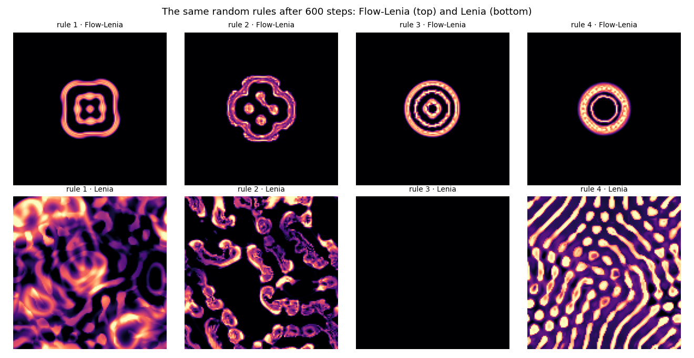
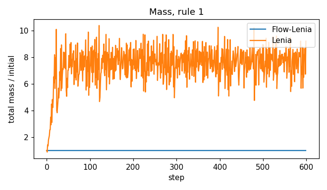

# Flow-Lenia: conserving mass makes creatures

Reproduction of E. Plantec, G. Hamon, M. Etcheverry, P.-Y. Oudeyer, C. Moulin-Frier and
B. W.-C. Chan, *Flow-Lenia: Towards open-ended evolution in cellular automata through mass
conservation and parameter localization*, ALIFE 2023,
[arXiv:2212.07906](https://arxiv.org/abs/2212.07906), following the authors' code
([erwanplantec/FlowLenia](https://github.com/erwanplantec/FlowLenia)) wherever the paper leaves
a value open.

Lenia creates and destroys matter freely, so most rules either die out or fill the world.
Flow-Lenia keeps Lenia's sensing but **moves** matter instead, along a flow, so the total mass
never changes. The paper's claim is that most patterns then become *spatially localised
patterns* (creatures).



**▶ Live:** [the reproductions viewer, Flow-Lenia](../live/index.html#flowlenia)

## Model

| Element | Paper | Here ([flow_lenia.py](flow_lenia.py)) |
|---|---|---|
| Affinity | U = Σ_k h_k G_k(K_k ∗ A) (Eq. 3), G = 2 exp(−(μ − x)²/(2σ²)) − 1 | same, 10 kernels (the code's default) |
| Kernels | K(x) = Σ_j b_j exp(−((x/(rR) − a_j)²)/(2w_j²)), 3 rings (Eq. 1) | same, with the code's R + 15 for R and its smooth cut at the kernel's edge |
| Flow | F = (1 − α)∇U − α∇A_Σ, α = clip((A_Σ/θ_A)ⁿ, 0, 1) (Eq. 5) | same, gradients by Sobel filters as in the code |
| θ_A, n | "critical mass", no value; n = 2 | θ_A = 1 (the code: the number of channels), n = 2 |
| Transport | reintegration tracking: each cell's matter as a square of side 2s centred at p + dt F, shared among the cells it overlaps (Eq. 6–7; Moroz 2020) | same, dt = 0.2, s = 0.65, displacement clipped to dd − s with dd = 5 (Table 1 and code) |
| Parameters | R ∈ [2, 25], r ∈ [0.2, 1], μ ∈ [0.05, 0.5], σ ∈ [0.001, 0.18], h ∈ [0.01, 1], a, b ∈ [0, 1]³, w ∈ [0.01, 0.5]³ | sampled from the same ranges |
| Start | a 40 × 40 patch | a 40 × 40 patch of uniform noise in a 128² world |

**Differences:** the code scales kernel radii by R + 15, while the paper writes R; the code's
form is used here. The code's border is a wall; here the world is a torus, as in EvoMaxx.

**Lenia for comparison:** the same rule, kernels and start, updated by A ← clip(A + dt U).

## Results

80 random rules, 600 steps each, every rule in both systems from the same start. A run is
*localised* when its matter is compact (radius of gyration under a quarter of the world) and
dense (at least half the mass in cells above 0.1); *dead* when under 1 % of the mass is left;
*spread* otherwise.

| 80 random rules | localised | spread | dead | largest change of total mass |
|---|---|---|---|---|
| **Flow-Lenia** | **78** | 2 | 0 | 1.9 × 10⁻¹⁴ (machine precision) |
| Lenia | 1 | 36 | 43 | ×8.4 |

Paired by rule: 77 rules localise only in Flow-Lenia, none only in Lenia (exact McNemar
p ≈ 10⁻²³). This reproduces the paper's claim that "most of the patterns generated in Flow
Lenia are SLPs" and that Lenia patterns are mostly "vanishing or exploding".



## In EvoMaxx

Every EvoMaxx physics that moves matter moves it by **reintegration tracking**: hue
transport, colour flocking, chemotaxis, swirl, currents and physarum. Each cell's colour is
spread as a small square where its velocity takes it, so each chemical's total is conserved.
EvoMaxx keeps the 5 × 5 neighbourhood and caps speeds at one cell per step.

What is EvoMaxx's own is the velocity. In Flow-Lenia matter flows up the affinity gradient;
in EvoMaxx's hue transport a cell's **hue is its heading and its saturation its speed**,
v = τ · chroma / max(r, g, b). Colour itself decides where matter goes.

## Running

```bash
./flow_lenia.py      # 80 rules x 2 systems x 600 steps: about 4 minutes on 16 cores
```

Python 3 with NumPy, SciPy, Matplotlib and Pillow.
