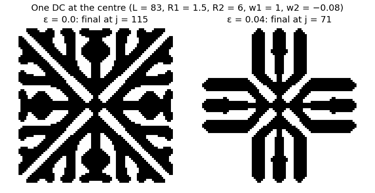
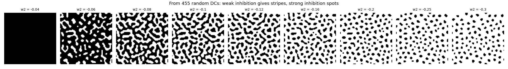

# Local activation, long-range inhibition: Young's skin patterns

Reproduction of D. A. Young, *A local activator-inhibitor model of vertebrate skin patterns*,
Mathematical Biosciences 72 (1984) 51–58, with the rules and parameters as restated by
R. Piasecki, W. Olchawa and K. Smaga, *Sensitivity to initial conditions in an extended
activator-inhibitor model for the formation of patterns*, Acta Physica Polonica B 49 (2018)
961, [doi:10.5506/APhysPolB.49.961](https://doi.org/10.5506/APhysPolB.49.961).

Turing's mechanism of pattern formation reduced to its core: a differentiated (pigmented)
cell activates its close neighbours and inhibits those further away. Young showed that this
alone gives the spots and stripes of animal skins.



**▶ Live:** [the reproductions viewer, activator–inhibitor](../live/index.html#young)

## Model

| Element | Paper (Piasecki et al., Eqs. 1–2) | Here ([young.py](young.py)) |
|---|---|---|
| Grid | L × L, periodic, L = 83 | same |
| Field | W(x) = Σ_{DC at r ≤ R₁} w₁ + Σ_{DC at R₁ < r ≤ R₂} w₂ | same, by FFT, rounded to exact sums |
| Parameters | R₁ = 1.5, R₂ = 6, w₁ = 1, w₂ = −0.08 | same; w₂ is varied in the second experiment |
| Update | all cells at once: W > ε → DC, W < ε → UC, W = ε → unchanged; ε = 0 is Young's model | same |
| Step count | iterate until n⁺(j) = n⁻(j) = 0; the final step j is that iteration | same |
| Random start | 455 DCs at random sites | same |

**Not stated:** whether a cell counts itself (the DC at r = 0) in its own sum. The single-cell
test below settles it: only with the cell counting itself does the pattern stop at the
paper's step.

## Results

**The test patterns, exactly.** From one DC at the centre (w₂ = −0.08):

| | here | paper (Fig. 2) |
|---|---|---|
| ε = 0 (Young's model) | stable at step **115**, 4,157 DCs | final step j = 115 |
| ε = 0.04 (slightly hostile) | stable at step **71**, 2,521 DCs | final step j = 71 |
| ε = 0, cell not counting itself | a 2-cycle from step 111 | – |

The final patterns have the shapes of the paper's Fig. 2 (a square lattice with diagonal arms
at ε = 0, a cross at ε = 0.04).

**Spots and stripes.** From 455 random DCs, 20 starts per value:

| w₂ | −0.04 | −0.06 | −0.08 | −0.10 | −0.12 | −0.16 | −0.20 | −0.25 | −0.30 |
|---|---|---|---|---|---|---|---|---|---|
| DC fraction | 1.00 | 0.73 | 0.54 | 0.42 | 0.34 | 0.26 | 0.22 | 0.18 | 0.16 |
| patches | 1 | 3 | 17 | 52 | 80 | 104 | 109 | 107 | 103 |
| elongation (median) | – | 1.63 | 1.79 | 2.00 | 1.82 | 1.47 | 1.39 | 1.37 | 1.36 |
| iterations to stable (median) | 10 | 12 | 12 | 12 | 12 | 11.5 | 12 | 12 | 11 |

Weak inhibition gives connected stripes and labyrinths; strong inhibition gives round spots.
Without enough inhibition (w₂ = −0.04) everything differentiates. Young remarked that "five
iterations suffice for convergence to a stable pattern". Here random starts need a median of
about 12, which agrees with Piasecki et al.'s finding that more iterations are needed. Two
of the 180 random runs ended in a 2-cycle, the oscillations those authors also describe.



## In EvoMaxx

Young's field is a step-shaped **Mexican hat**: positive in the middle, negative around it.
EvoMaxx's Mexican hat kernel is its smooth form, a difference of Gaussians normalised so that
its positive and negative parts weigh +1 and −1. It is part of EvoMaxx's default rule:
Mexican hat · v1 decay · tangent · hue transport was lifelike for 95 % of fresh genomes in
EvoMaxx's experiments, against 7 % for the original v1 rule (box kernels, v1 decay, Gaussian genes).

## Running

```bash
./young.py      # about 15 seconds
```

Python 3 with NumPy, SciPy and Matplotlib.
