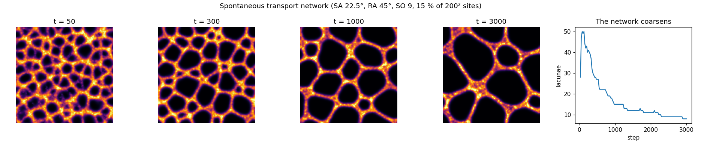
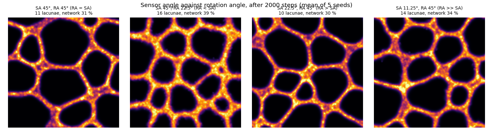

# Physarum: a transport network from a few rules

Reproduction of the particle model of J. Jones, *Characteristics of pattern formation and
evolution in approximations of Physarum transport networks*, Artificial Life 16 (2010)
127–153, as described with its parameters in J. Jones, *Influences on the formation and
evolution of Physarum polycephalum inspired emergent transport networks*, Natural Computing 10
(2011) 1345–1369 (Sect. 2, Figs. 1–2).

The slime mould *Physarum polycephalum* builds efficient networks of veins without any
nervous system. Jones's model: particles that sense a chemical trail ahead of them, turn
towards it, move and leave more trail. A network forms by itself and keeps reorganising.



**▶ Live:** [the reproductions viewer, Physarum](../live/index.html#physarum)

## Model

| Element | Paper (2011, Figs. 1–2) | Here ([physarum.c](physarum.c), [physarum.py](physarum.py)) |
|---|---|---|
| World | lattice, periodic boundary | 200 × 200, periodic |
| Population | 1–15 % of the sites, one particle per site | 15 % (6,000 particles) |
| Sensors | three, at distance SO ahead and at ±SA, 1 pixel wide | SO = 9, SA as stated per run |
| Turning | front strongest: keep; front weakest: turn randomly by ±RA; else turn by RA towards the stronger side (Fig. 1) | same |
| Moving | step SS = 1 forward if the site is free, then deposit depT = 5 | same |
| Order | random order, for both the sensory and the motor stage | same (sensory stage, then motor stage) |
| Trail | 3 × 3 mean filter, damping factor 0.1 | same: trail ← 0.9 × mean |

**Not stated in the 2011 paper:** what a particle does when its move is blocked. Here, as in
Jones (2010), it stays, deposits nothing and picks a new random heading.

## Results

**The network forms by itself and coarsens** (SA 22.5°, RA 45°). From random positions a fine
mesh appears within 50 steps. It then evolves as the paper describes: "the smaller lacunae
gradually close", so the network coarsens. The number of lacunae (holes enclosed by the
network, at least 4 sites) falls from 49 at step 100 to 27, 15, 11 and 8 at steps 500, 1,000,
2,000 and 3,000.

**The sensor and rotation angles: not reproduced.** The paper states that RA = SA contracts the
network, RA < SA contracts it more, and RA > SA makes it branch. After 2,000 steps (5 seeds
each):

| SA | RA | case | lacunae | network (share of sites) |
|---|---|---|---|---|
| 45° | 45° | RA = SA | 11.0 | 31 % |
| 45° | 22.5° | RA < SA | 16.4 | 39 % |
| 22.5° | 45° | RA > SA | 9.6 | 30 % |
| 11.25° | 45° | RA ≫ SA | 13.8 | 34 % |

All four form similar networks. RA < SA gives the *finest* network, not the most contracted,
and the same holds at 3 % and 6 % population (RA < SA: 12.0 lacunae; RA = SA: 5.7–7.3;
RA > SA: 5.3–9.0). The paper's statement is qualitative and points to a full study (Jones
2010a). Our measures (lacunae, network area) may not capture what it means by contraction,
for example the speed at which a given network shrinks. We report it as not reproduced
under these measures.



## In EvoMaxx

EvoMaxx's **physarum** physics is this rule made continuous and coloured. There are no
particles: every cell's **hue is its heading**. A cell senses the neighbourhood field ahead-left
and ahead-right along its heading (at distance r), turns its hue towards the side where its
own colour is stronger (Δθ = κ(s_L − s_R)/(s_L + s_R) + ω), and then moves by hue transport.
Like Jones's particles it is drawn to its own kind's trail, but the trail is the chemistry
itself.

It was EvoMaxx's most successful new physics. With the gaze kernel, multiplicative delta and
Gabor response it formed localised creatures for 82 % of fresh genomes, against 22 % for the
best rule before it, with no genome lost (p ≈ 10⁻⁷).

## Running

```bash
./physarum.py      # builds libphysarum.so with cc, then about 3 minutes
```

Python 3 with NumPy, SciPy, Matplotlib and Pillow, and a C compiler.
