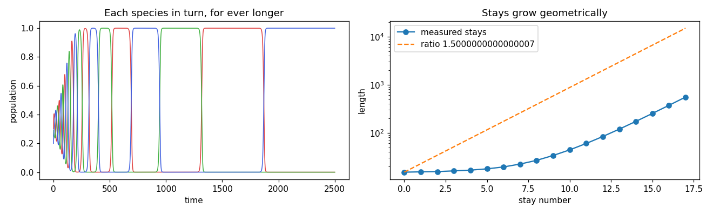
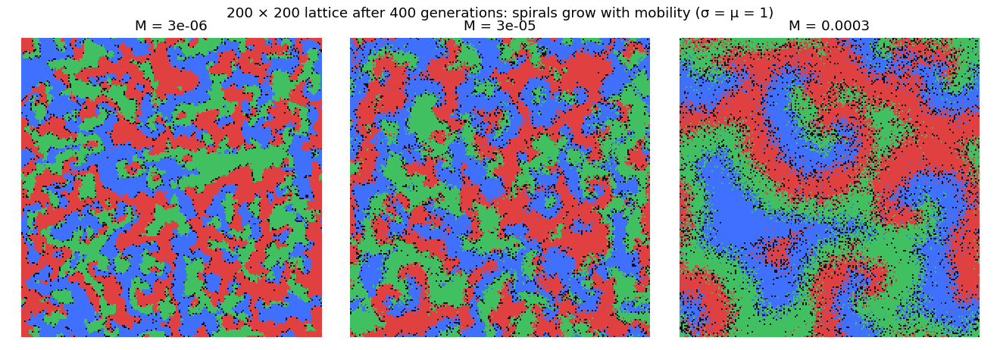
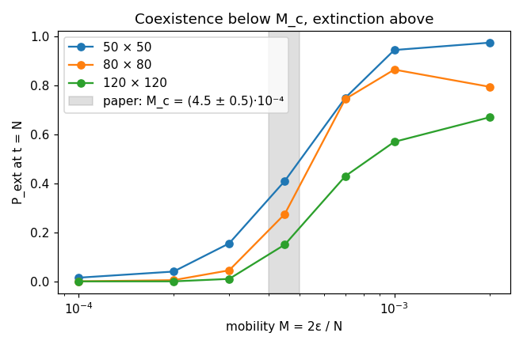

# Cyclic dominance: rock, paper, scissors

Two reproductions of cyclic competition, where A beats B, B beats C and C beats A:

1. R. M. May and W. J. Leonard, *Nonlinear aspects of competition between three species*,
   SIAM Journal on Applied Mathematics 29 (1975) 243–253. These are the well-mixed equations.
2. T. Reichenbach, M. Mobilia and E. Frey, *Mobility promotes and jeopardizes biodiversity in
   rock-paper-scissors games*, Nature 448 (2007) 1046–1049. This is the spatial, stochastic
   version, where the three species form spiral waves.

With no winner, no species can win outright. In a well-stirred pot the three take turns,
each for longer than the one before. On a lattice they chase each other in spirals and
coexist, unless they move too fast.



**▶ Live:** [the reproductions viewer, cyclic dominance](../live/index.html#cyclic)

## Model

| Element | Paper | Here ([rps.py](rps.py), [rps.c](rps.c)) |
|---|---|---|
| May–Leonard | dN₁/dt = N₁(1 − N₁ − αN₂ − βN₃), and cyclically for N₂ and N₃ | same; α = 0.8, β = 1.3 (α < 1 < β, α + β > 2) |
| Prediction | the interior point is unstable and the orbit approaches a heteroclinic cycle; each stay lasts (β − 1)/(1 − α) times the one before | the ratio is (1.3 − 1)/(1 − 0.8) = 1.5 |
| Numerics | – | integrated in log variables (the populations come within 10⁻³⁰ of zero), rtol 10⁻¹⁰; a stay is the time one species leads |
| Lattice | L × L periodic; each site empty or A, B, C; a random site and one of its 4 neighbours react | same, in C |
| Reactions | selection AB → A0 (rate σ), reproduction A0 → AA (μ), exchange XY → YX (ε) | σ = μ = 1; mobility M = 2ε/N |
| Time | one generation = N reactions per unit rate | N(σ + μ + ε) draws per generation |
| Measure | P_ext: the probability that two species are extinct at t = N | same; 200 runs per point; L = 50, 80, 120 |
| Paper's threshold | M_c = (4.5 ± 0.5) × 10⁻⁴ | compared |

**Not stated in the paper:** the initial condition. Here every site starts empty, A, B or C
with probability ¼ each.

## Results

**May–Leonard: reproduced.** The stays grow geometrically: 15.2, 15.4, 15.6, 16.1, 16.7,
17.8, 19.5, 22.4, … 372.8, 552.8. The ratio of one stay to the next rises towards the
predicted 1.5 as the orbit nears the cycle: 1.448, 1.463, 1.476, 1.483 for the last four.

**The lattice: patches, then spirals.** The species' domains grow with mobility. At
M = 3·10⁻⁶ and 3·10⁻⁵ they are small, irregular patches; at 3·10⁻⁴, just below M_c, they
wind into the paper's rotating spirals, a sizeable fraction of the lattice across (figure 2).



**The mobility threshold: reproduced, with a caveat about the time unit.**

| M | 1·10⁻⁴ | 2·10⁻⁴ | 3·10⁻⁴ | 4.5·10⁻⁴ | 7·10⁻⁴ | 1·10⁻³ | 2·10⁻³ |
|---|---|---|---|---|---|---|---|
| P_ext, 50 × 50 | 0.02 | 0.04 | 0.16 | 0.41 | 0.75 | 0.94 | 0.98 |
| P_ext, 80 × 80 | 0.00 | 0.00 | 0.04 | 0.28 | 0.74 | 0.86 | 0.80 |
| P_ext, 120 × 120 | 0.00 | 0.00 | 0.01 | 0.15 | 0.43 | 0.57 | 0.67 |

Below M_c, extinction becomes rarer as the lattice grows, and P_ext goes to 0. This is the
paper's central claim, that biodiversity is safe in large systems below the threshold, and it
is reproduced. Above M_c the paper has P_ext rising towards 1 with lattice size at t = N.
Ours rises steeply with M but, at t = N, still falls with lattice size, so the curves do not
cross. Run four times as long (t = 4N), at M = 2·10⁻³, P_ext is 0.97 for both 80 × 80 and
120 × 120 (0.80 and 0.67 at t = N). Above M_c, extinction does become near-certain, but later
in our clock than in theirs. The most likely difference is the time convention, that is, how
many reactions make one generation. We report the threshold's low side as reproduced and its
high side as reproduced only at four times the stated time.



## In EvoMaxx

EvoMaxx's three chemicals are three species, and the **cyclic dominance** delta adds the
rock-paper-scissors term to them: x_c += ρ x_c (x_{c+1} − x_{c−1}). Red eats green, green eats
blue and blue eats red, and the total is conserved. With the spreading of EvoMaxx's
neighbourhoods this is the spatial game, and EvoMaxx worlds can show the same spirals. The
**colour game** physics uses the related replicator dynamics to move matter. v1 already
listed "territorial dynamics: species competing for space" among the modes it saw emerge.
In the v10 experiments, cyclic dominance with the tangent response was lifelike for 85 % of
fresh genomes. The live viewer shows the reaction–diffusion form of the lattice game, with a
mobility slider.

## Running

```bash
./rps.py      # compiles rps.c, then runs the lattices on every core
```

Python 3 with NumPy, SciPy and Matplotlib, and a C compiler (`cc`).
