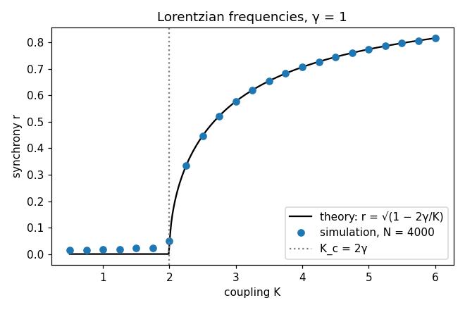

# Kuramoto: the onset of synchrony

Reproduction of the synchronisation transition of Y. Kuramoto, *Self-entrainment of a
population of coupled non-linear oscillators*, International Symposium on Mathematical
Problems in Theoretical Physics, Lecture Notes in Physics 39 (1975) 420–422, in the form
reviewed by S. H. Strogatz, *From Kuramoto to Crawford: exploring the onset of
synchronization in populations of coupled oscillators*, Physica D 143 (2000) 1–20.

Oscillators that each have their own natural speed, all pulled towards each other's phases.
Weakly coupled, they run independently; above a critical coupling a growing group locks
together. Kuramoto solved this exactly.



**▶ Live:** [the reproductions viewer, Kuramoto](../live/index.html#kuramoto)

## Model

| Element | Kuramoto / Strogatz | Here ([kuramoto.py](kuramoto.py)) |
|---|---|---|
| Dynamics | dθ_i/dt = ω_i + (K/N) Σ_j sin(θ_j − θ_i) | same, in the equivalent mean-field form ω_i + K r sin(ψ − θ_i) |
| Order parameter | r e^{iψ} = (1/N) Σ_j e^{iθ_j} | same |
| Frequencies | Lorentzian g(ω) = γ / (π(γ² + ω²)) | γ = 1, taken at N regular quantiles (no sampling noise) |
| Prediction | K_c = 2γ; r = √(1 − K_c/K) for K > K_c (exact as N → ∞) | compared directly |
| Numerics | – | N = 4,000, RK4 with dt = 0.02 to t = 200; r averaged over the second half |

## Results

| K | 1.0 | 2.0 | 2.25 | 2.5 | 3.0 | 4.0 | 5.0 | 6.0 |
|---|---|---|---|---|---|---|---|---|
| r measured | 0.017 | 0.050 | 0.333 | 0.447 | 0.577 | 0.707 | 0.775 | 0.817 |
| r theory | 0 | 0 | 0.333 | 0.447 | 0.577 | 0.707 | 0.775 | 0.816 |

Above K = 2.5 the measured synchrony matches √(1 − 2γ/K) to three decimals. Below K_c it sits
at the finite-size floor (about 1/√N). The agreement is this close because the frequencies
are the Lorentzian's quantiles, not random draws. With random draws the same curve appears,
with finite-size scatter around it.

## In EvoMaxx

EvoMaxx's **colour flocking** is Kuramoto coupling on the colour wheel. A cell's hue θ turns
towards the hue of its neighbourhood, Δθ = κ |c_N| sin(θ_N − θ) + ω: the sine coupling, with
strength proportional to how saturated the neighbourhood is, and a chirality ω in the role of
the natural frequency. Because a cell's hue is also its heading in EvoMaxx, aligning colours
aligns motion, and matter flocks. The live viewer shows the lattice form: every oscillator is
coupled only to its eight neighbours, coloured by phase. There the natural frequencies are
scaled down (× 0.15) so that local order can grow.

## Running

```bash
./kuramoto.py      # about 3 minutes
```

Python 3 with NumPy and Matplotlib.
