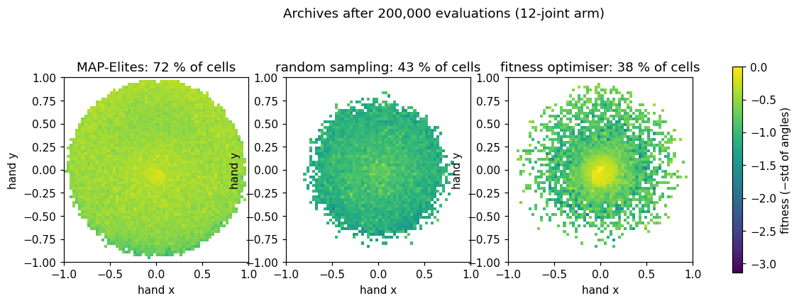
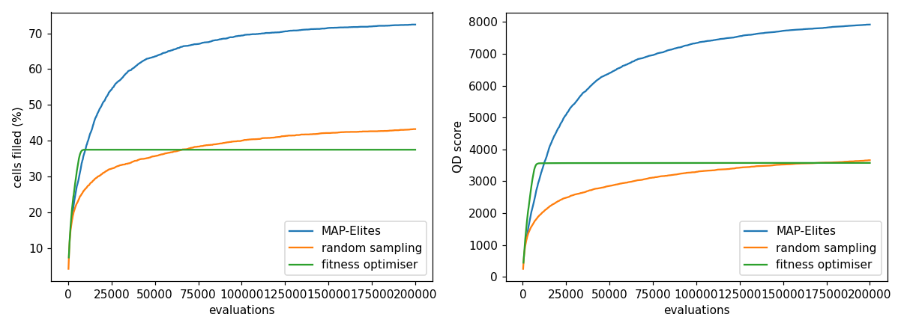

# MAP-Elites: illuminating a search space

Reproduction of the central claim of J.-B. Mouret and J. Clune, *Illuminating search spaces
by mapping elites*, [arXiv:1504.04909](https://arxiv.org/abs/1504.04909) (2015).

An optimiser looks for the single best solution. MAP-Elites instead keeps the best solution
of **each kind**. It lays a grid over chosen features of the solutions and keeps one elite per
cell, so the result is a map of what is possible and how good each kind can be. The paper
claims that for the same number of evaluations it finds more kinds and better ones than
random sampling or an optimiser of the objective alone.



**▶ Live:** [the reproductions viewer, MAP-Elites](../live/index.html#mapelites)

## Model

| Element | Paper | Here ([map_elites.py](map_elites.py)) |
|---|---|---|
| Algorithm | random start; then repeat: random elite → mutate → evaluate → keep if its cell is empty or it is better | same: 2,000 random genomes, then batches of 200 children, Gaussian mutation σ = 0.1 |
| Domain | soft robots, neural networks, others | **not the paper's**: the planar arm benchmark of later quality-diversity work (e.g. Vassiliades et al. 2018). 12 joints, angles in [−π, π], links of 1/12 |
| Features | domain-specific | the hand's position in [−1, 1]², on a 64 × 64 grid |
| Objective | domain-specific | smoothness: minus the standard deviation of the joint angles |
| Comparisons | random sampling, a traditional optimiser, novelty search | random sampling, and a (μ + λ) evolution strategy on the objective alone, both archived the same way |
| Budget | – | 200,000 evaluations, 5 seeds each |

## Results

| method | cells filled | QD score (sum of fitness + π) | mean fitness of the elites |
|---|---|---|---|
| **MAP-Elites** | **72.5 %** (sd 0.1) | **7,923** | **−0.47** |
| random sampling | 43.0 % (sd 0.2) | 3,644 | −1.07 |
| fitness optimiser | 31.9 % (sd 6.8) | 3,031 | −0.84 |

MAP-Elites reaches far more of the space than random sampling (1.7×) and the optimiser
(2.3×). Its elites are also *better* in the cells they fill: their mean smoothness is higher
than random sampling's, and even higher than the optimiser's, whose solutions all crowd
round the single smoothest arm. That is the paper's claim. (The optimiser's best single arm
is of course as smooth as any.)



## In EvoMaxx

EvoMaxx's **Discover** mode is MAP-Elites. Genomes of the current rule are tested nine at a
time on small worlds. Each is kept in an 8 × 8 atlas by the hue of its world's mean colour and
by its activity (how fast the world changes), one elite per cell, by quality: the experiments'
measure of structured, moving life. The atlas shows the kinds of organism a rule can make,
rather than a single "best" one. Click any of them to open it.

## Running

```bash
./map_elites.py      # 3 methods x 5 seeds x 200,000 evaluations: about 2 minutes
```

Python 3 with NumPy and Matplotlib.
