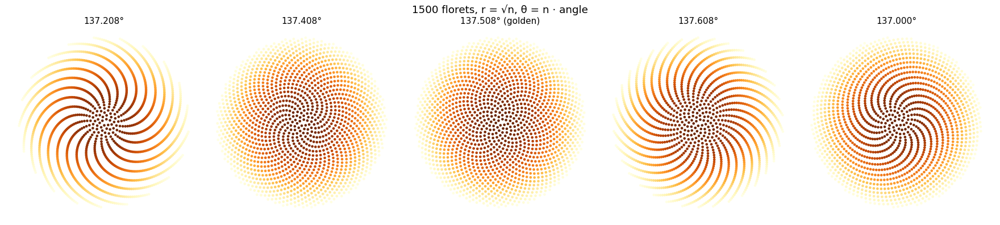
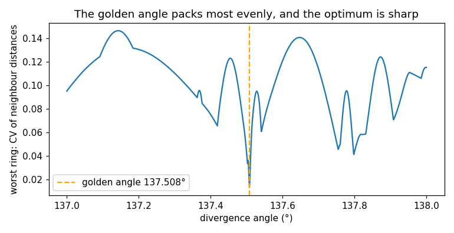

# Phyllotaxis: the golden angle

Reproduction of H. Vogel, *A better way to construct the sunflower head*, Mathematical
Biosciences 44 (1979) 145–174.

Vogel's model of a sunflower head: floret n sits at radius c√n and angle n · 137.508°, the
golden angle 360°(2 − φ). The paper argues that this angle, and only this angle, packs the
florets evenly from the centre to the rim. Departing from it by a fraction of a degree opens
gaps and spokes. The spirals the eye picks out (parastichies) come in consecutive Fibonacci
numbers.



**▶ Live:** [the reproductions viewer, phyllotaxis](../live/index.html#phyllotaxis)

## Model

| Element | Paper | Here ([vogel.py](vogel.py)) |
|---|---|---|
| Positions | r_n = c√n, θ_n = n · α | same, c = 1 |
| Divergence angle | α = 137.508° (golden) and nearby values | the golden angle, a fine scan over 137–138° in steps of 0.0005°, and 137.0° |
| Uniformity | judged from the figures | measured: in five rings from the centre outwards, the spread (coefficient of variation) of the nearest-neighbour distances; the worst ring counts |
| Parastichies | counted by eye | the two commonest index differences to each floret's four nearest neighbours, ring by ring |

## Results

**The golden angle packs best, and the optimum is sharp.** Over 2,000 florets the most even
packing and the widest minimum spacing both fall at the golden angle (137.508°; widest
spacing at 137.507°). The worst-ring spread there is 0.013. Off by −0.1° it is 0.071, off by
+0.1° 0.127, and at 137.0° 0.095. A tenth of a degree makes the packing 5 to 10 times less even.



The metric has to judge the whole head. An earlier version measured one band of radii only,
and it rewarded other angles. For example, 139.525°, another "noble" angle whose continued
fraction ends in ones like the golden ratio's, packs well far from the centre but badly near
it. Only the golden angle is even at every radius, which is Vogel's point.

**Parastichies are consecutive Fibonacci numbers, larger ones further out:**

| florets | 30–80 | 100–250 | 300–700 | 900–1,800 | 2,500–4,500 |
|---|---|---|---|---|---|
| parastichies | 13, 21 | 21, 34 | 34, 55 | 55, 89 | 89, 144 |

## In EvoMaxx

EvoMaxx's **phyllotaxis kernel** samples a cell's neighbourhood at Vogel's sunflower points
(r = 0.9√n, angle n · 137.5°, splatted bilinearly onto the stencil) instead of on rings. It is a
chiral, uneven way to sense the neighbours. With physarum physics it formed localised
creatures for 72 % of fresh genomes in EvoMaxx's experiments.

## Running

```bash
./vogel.py      # about 30 seconds
```

Python 3 with NumPy, SciPy and Matplotlib.
