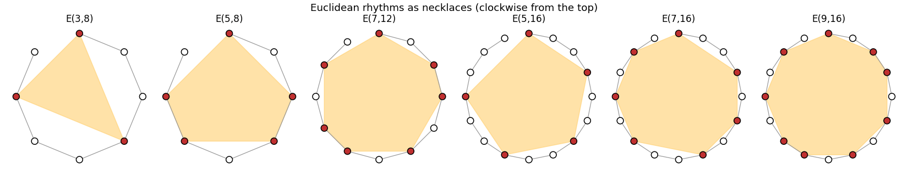

# Euclidean rhythms

Reproduction of G. T. Toussaint, *The Euclidean algorithm generates traditional musical
rhythms*, Proceedings of BRIDGES: Mathematical Connections in Art, Music and Science (2005)
47–56 ([pdf](https://cgm.cs.mcgill.ca/~godfried/publications/banff.pdf)).

Spread k beats as evenly as possible over n pulses. Bjorklund's algorithm does this (it was
written for neutron accelerators and has the structure of Euclid's algorithm). Toussaint
found that the results are the timelines of traditional music across the world: the Cuban
tresillo, the cinquillo, West African bell patterns, the Bossa-Nova.



**▶ Live (with sound):** [the reproductions viewer, Euclidean rhythms](../live/index.html#rhythms)

## Model

| Element | Paper | Here ([euclid.py](euclid.py)) |
|---|---|---|
| Algorithm | Bjorklund's, performed as in Sect. 3: k groups [1] and n − k groups [0]; repeatedly append one remainder group to each leading group until at most one remainder is left | same |
| Rhythms | 21 named E(k, n) in box notation (Sect. 4) | all 21, compared symbol by symbol |
| Strings | Euclidean strings (Ellis et al. 2003): P is one if τ(P) (first interval + 1, last − 1) is a rotation of P; reverse ones likewise backwards (Sect. 5) | same, on the interval vectors |

## Results

**The algorithm gives the paper's rhythms.** 20 of the 21 match symbol for symbol. The 21st,
E(5,16), is printed as `x . . x . . x . . x . . x . . . .`, which has **17** symbols for 16
pulses: a typo in the paper. Its own interval vector (33334) sums to 16 and matches the
algorithm's `x . . x . . x . . x . . x . . .`.

**The paper's classification agrees for all 22 rhythms.** E(2,5), E(3,7), E(4,9), E(5,11) and
E(5,16) are Euclidean strings. Thirteen, from E(2,3) to E(11,24), are reverse Euclidean
strings. E(5,8), E(7,12), E(9,16) and E(13,24) are neither. As the paper notes, those last
are used only in sub-Saharan African music.

Getting the exact rotations right matters. A common shortcut of the algorithm (stop as soon
as one remainder group is left, even before the first pairing) gives rotations of E(3,4),
E(5,6) and E(7,8), and then their string classification changes. The paper's own procedure
gives the printed forms.

## In EvoMaxx

EvoMaxx's **Euclidean** drum style plays E(k, 16) patterns whose k is set by the world: the
kick's pulse count by the number of red bodies, the snare's by the green ones and the hats'
by the blue ones. The ecology writes the groove, and when bodies are born or die, the
rhythm changes.

EvoMaxx computes the pattern in closed form, "pulse s sounds if (s · k) mod n < k". The
reproduction checks that this gives a rotation of Bjorklund's rhythm, so the same necklace,
for **all 560** pairs (k, n) with n ≤ 32.

## Running

```bash
./euclid.py      # a second
```

Python 3 with NumPy and Matplotlib.
