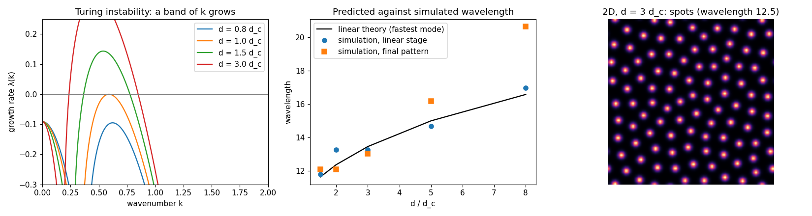

# Turing patterns: how a stable mixture makes spots

Reproduction of the diffusion-driven instability of A. M. Turing, *The chemical basis of
morphogenesis*, Philosophical Transactions of the Royal Society B 237 (1952) 37–72, with the
activator–inhibitor kinetics of A. Gierer and H. Meinhardt, *A theory of biological pattern
formation*, Kybernetik 12 (1972) 30–39, in the dimensionless form of J. D. Murray,
*Mathematical Biology II* (3rd ed., 2003), §2.3.

Two chemicals react and the uniform mixture is stable. Turing's discovery was that letting
them diffuse at different rates can make it unstable: the even mixture breaks into spots or
stripes of a definite size, from nothing but noise. Linear stability analysis predicts both
when this happens and the size.



**▶ Live:** [the reproductions viewer, Turing patterns](../live/index.html#turing)

## Model

| Element | Turing / Gierer–Meinhardt / Murray | Here ([turing.py](turing.py)) |
|---|---|---|
| Activator | ∂u/∂t = a − bu + u²/v + ∇²u | same, a = 0.1, b = 1 |
| Inhibitor | ∂v/∂t = u² − v + d∇²v | same |
| Uniform state | u* = (a + 1)/b, v* = u*² | u* = 1.1, v* = 1.21; stable without diffusion (trace −0.182 < 0, det 1.0 > 0) |
| Turing condition | d f_u + g_v > 2√(d det J) | the smallest such d: **d_c = 8.238** |
| Wavelength | 2π/k_max, where k_max is the fastest-growing mode of λ(k) | computed from the eigenvalues of J − k² diag(1, d) |
| Numerics | – | explicit Euler, periodic grid, Δx = 1, Δt at half the diffusive limit; start from the uniform state plus 1 % noise; 1D, 512 cells for wavelengths, 256 for the onset |

## Results

**The threshold: reproduced.** Below d_c the noise dies away; just above it a pattern grows.

| d / d_c | 0.8 | 0.95 | 1.05 | 1.5 | 3.0 |
|---|---|---|---|---|---|
| largest linear growth rate | −0.091 | −0.021 | +0.019 | +0.144 | +0.330 |
| pattern amplitude (std of u at t = 800) | 3·10⁻¹⁵ | 9·10⁻¹¹ | 0.269 | 0.547 | 0.823 |

**The wavelength: reproduced near onset.** The wavelength measured early on (the linear
stage, while the pattern is still small) follows the fastest-growing mode. The final pattern
keeps it close to onset and drifts longer far above it, where the nonlinear pattern is no
longer the linear one.

| d / d_c | 1.5 | 2 | 3 | 5 | 8 |
|---|---|---|---|---|---|
| predicted (fastest mode) | 11.65 | 12.38 | 13.47 | 15.00 | 16.58 |
| simulated, linear stage | 11.82 | 13.29 | 13.29 | 14.69 | 16.99 |
| simulated, final pattern | 12.10 | 12.10 | 13.04 | 16.17 | 20.64 |

On a ring of 512 cells only wavelengths 512/m fit (about 0.3 apart near 12), so the measured
values are quantised; each is the mean of 3 runs. In 2D, at d = 3 d_c, the pattern is spots
with a wavelength of 12.5 (figure, right).

## In EvoMaxx

EvoMaxx began as reaction–diffusion. v1's README opens with "open-ended evolution of
reaction-diffusion gene regulatory networks", its update is "a proper RD update:
multiplicative decay plus additive GRN input", and the first mode it lists is "Turing
patterns: stripes, spots, labyrinths". Every EvoMaxx step is still reaction plus spreading.
The genes are the reactions, and the neighbourhood averages at three scales play the part of
diffusion at different rates. That difference in reach is exactly what Turing needs.
EvoMaxx's **Mexican hat** kernel puts short-range activation and long-range inhibition into
one kernel (reproduction [03](../03_activator_inhibitor_young1984/)). The live viewer runs
these equations on the GPU, with the diffusion ratio as a slider measured in units of d_c.

## Running

```bash
./turing.py
```

Python 3 with NumPy and Matplotlib.
