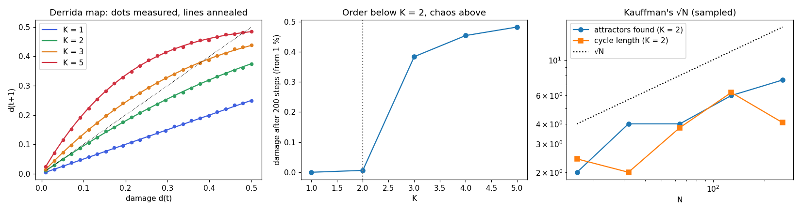

# Random Boolean networks: order, chaos and the edge between

Reproduction of S. A. Kauffman, *Metabolic stability and epigenesis in randomly constructed
genetic nets*, Journal of Theoretical Biology 22 (1969) 437–467, with the annealed
approximation of B. Derrida and Y. Pomeau, *Random networks of automata: a simple annealed
approximation*, Europhysics Letters 1 (1986) 45–49.

Kauffman's question: if a cell's genes are wired together at random, is the result
hopelessly chaotic? He found that with two inputs per gene, random networks are orderly.
They fall into a few short cycles, which he read as cell types. With many inputs they are
chaotic. Derrida and Pomeau showed the transition is exactly at K = 2.



**▶ Live:** [the reproductions viewer, gene networks](../live/index.html#rbn)

## Model

| Element | Kauffman / Derrida–Pomeau | Here ([rbn.py](rbn.py)) |
|---|---|---|
| Genes | N, each on or off | same |
| Wiring | each gene reads K genes chosen at random | K distinct inputs |
| Rules | a random Boolean function per gene | each output 1 with probability ½ |
| Update | all genes at once | same |
| Damage map | d(t+1) = (1 − (1 − d)^K) / 2, slope K/2 at 0 | measured over 200 pairs of states in fresh networks, N = 500 |
| Long-run damage | the fixed point of the map | measured after 200 steps from 1 % damage, N = 1,000 |
| Attractors (K = 2) | roughly √N attractors, cycle lengths roughly √N | sampled from 300 random starts per network, 20 networks per N |
| K = N | cycle length of order 2^(N/2) | 20 starts per network, 10 networks |

## Results

**The Derrida map: reproduced.** One step of damage follows the annealed formula to within
0.005 at every point measured. The fitted slopes near d = 0 (0.52, 0.93, 1.37, 2.08 for
K = 1, 2, 3, 5) sit slightly under K/2 (0.5, 1, 1.5, 2.5) for large K, because the map
curves and the fit uses the first four points (up to d = 0.07).

**The transition: reproduced.** Long-run damage dies for K < 2 and settles on the annealed
fixed point for K > 2:

| K | 1 | 2 | 3 | 4 | 5 |
|---|---|---|---|---|---|
| damage after 200 steps | 0.000 | 0.006 | 0.384 | 0.454 | 0.482 |
| annealed fixed point | 0.000 | 0.003 (critical, slow decay) | 0.382 | 0.456 | 0.481 |

**Kauffman's attractors at K = 2: the trend, with the later correction.** The median number
of attractors found grows slowly with N: 2, 4, 4, 6, 7.5 at N = 16, 32, 64, 128, 256. That is
about N^0.48, as Kauffman reported. Median cycle lengths stay short (2.4, 2.0, 3.8, 6.3,
4.1). Sampling from a few hundred starts misses rare attractors. Exact counting (B.
Samuelsson and C. Troein, *Superpolynomial growth in the number of attractors in Kauffman
networks*, Phys. Rev. Lett. 90 (2003) 098701) later showed that the true number grows faster
than any power of N. The √N law is what sampling sees, which is how Kauffman measured.

**K = N: reproduced.** Fully random networks have long cycles: medians of 8, 38, 85 and 272
at N = 8, 12, 16, 20, growing like 2^(N/2) (16, 64, 256, 1024), with a constant factor below
it.

## In EvoMaxx

v1 described its genome as a **gene regulatory network**: eight genes, each a rule by which
one chemical (at one of three ranges) regulates another, compiled into a shader. EvoMaxx's
genes are continuous and spatial instead of Boolean, but Kauffman's question is EvoMaxx's
question: of all randomly wired regulatory networks, which are ordered, which chaotic, and
which sit between, where structure lasts and still changes. EvoMaxx's health measures sort
worlds as dead or frozen (order), noise (chaos) or alive (between), and its experiments count
how often a fresh random genome lands in the middle. The live viewer shows a network of 200
genes running down the screen beside a copy started one gene different, with the damage in
red.

## Running

```bash
./rbn.py
```

Python 3 with NumPy and Matplotlib.
