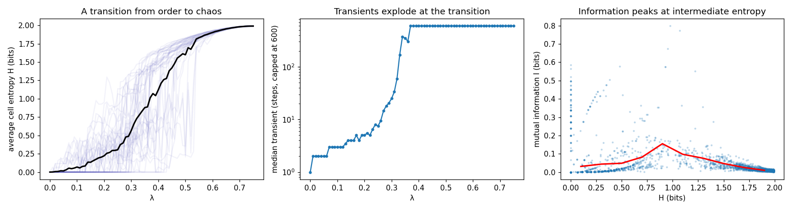
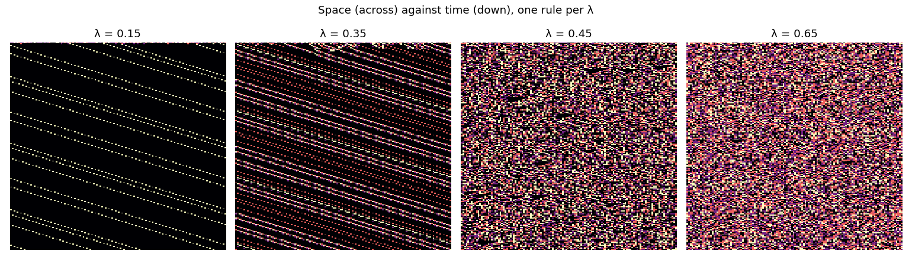

# The edge of chaos: Langton's λ

Reproduction of C. G. Langton, *Computation at the edge of chaos: phase transitions and
emergent computation*, Physica D 42 (1990) 12–37.

Langton looked for a single number that would say whether a cellular automaton rule is
ordered, chaotic or interesting. He found λ, the share of the rule table that does not lead
to the "dead" state. Raising λ slowly takes rules from frozen through a narrow transition to
chaos. The complex rules, the ones that might compute, live in that transition.



**▶ Live:** [the reproductions viewer, edge of chaos](../live/index.html#langton)

## Model

| Element | Langton | Here ([langton.py](langton.py)) |
|---|---|---|
| Automaton | 1D, K = 4 states, neighbourhood N = 5 (radius 2): a table of 4⁵ = 1,024 entries | same, 128 cells, periodic |
| Quiescent state | state 0; the all-0 neighbourhood maps to 0 | same |
| λ | the share of entries that map to a non-quiescent state | same |
| Table walk-through | start all-quiescent; replace entries one at a time, in a random order, with random non-quiescent states | same, λ from 0 to 0.75 in steps of 0.01 |
| Measures | average single-cell entropy H; mutual information I between a cell and itself one step later; transient length | same; H and I over steps 300–600 of each run; transient = first repeat of the whole configuration, capped at 600 steps |
| Sample | many walk-throughs | 40 walk-throughs |

## Results

**A transition from order to chaos: reproduced.** The mean entropy stays near 0 for small
λ, rises steeply through the middle, and saturates near its maximum of 2 bits. It rises most
steeply at λ = 0.37.

| λ | 0.1 | 0.2 | 0.3 | 0.4 | 0.5 | 0.6 | 0.7 |
|---|---|---|---|---|---|---|---|
| H (bits) | 0.07 | 0.22 | 0.57 | 1.12 | 1.60 | 1.90 | 1.98 |
| I (bits) | 0.009 | 0.065 | 0.080 | 0.061 | 0.024 | 0.011 | 0.007 |
| median transient (steps) | 3 | 5 | 25 | > 600 | > 600 | > 600 | > 600 |

**Transients explode at the transition: reproduced.** Median transients are a few steps in
the ordered region and outgrow the 600-step window from λ = 0.37 on, where the entropy
rises fastest. Beyond the transition, the "transient" of a chaotic rule on 128 cells is
simply longer than any practical window, so the cap is reported rather than a peak.

**Information peaks between order and chaos: reproduced.** Pooled over all walks and binned
by entropy (bins 0.2 bits wide), mutual information has a single hump. It rises from 0.03
bits for frozen rules (H < 0.2) to its largest value, 0.155 bits, at H = 0.8–1.0, about half
the maximum entropy, and falls to 0.01 bits for chaotic ones (H > 1.8). Frozen rules have no
information to carry, and random ones carry nothing over. This is Langton's central figure.
Finer bins make the same hump with a sharper top, but in the middle of the range they hold
fewer than 10 runs each, so their peak is not reported.



**Where the transition lies.** The λ at which a single walk-through jumps varies from walk
to walk, as in the paper (thin lines in the figure: each is one walk), and it also depends on
the lattice size and on how entropy is measured. The value 0.37 is where the *mean* of our 40
walks rises fastest. We claim the shape of the transition and the information peak, not a
particular λ.

## In EvoMaxx

EvoMaxx sorts its worlds the way Langton sorted rules. A world is **dead** or **frozen**
(order), **noise** (chaos), or **alive**: structure above the cell scale that keeps changing.
The experiments behind v10 are measurements of how often a rule family lands in the
middle band, and the morph and discover tools search for it. v1's fitness already aimed
there: it punishes a dead or saturated field and a field without variation, and rewards
middling brightness and texture. That was a hand-made λ, a score for "neither ordered nor
chaotic". The live viewer has λ as a slider over one walk-through, so the passage from
frozen to complex to noise can be watched.

## Running

```bash
./langton.py
```

Python 3 with NumPy and Matplotlib.
